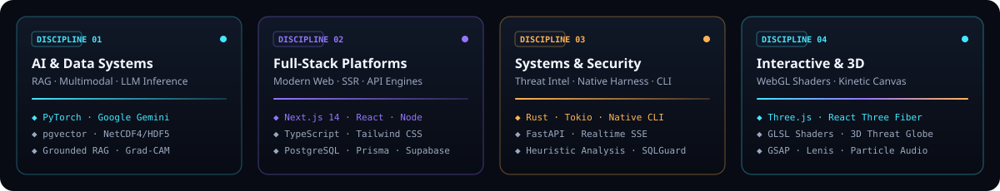
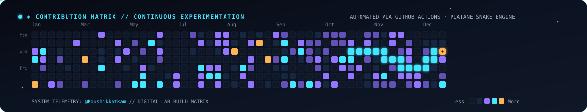

### Building reliable software architectures, intelligent systems, and interactive web experiences.

**Full-Stack Architecture · AI &amp; Data Systems · Cybersecurity · Creative WebGL &amp; 3D**

  

## `01` // Developer Bio &amp; Foundation

I am **Koushik Katkam**, a software developer and **B.Tech Data Science student at Kakatiya University College of Engineering and Technology, Warangal, Telangana, India**.

My development philosophy centers on moving rapidly from idea to functional software, iteratively hardening each layer into a production-grade system. Whether engineering deep-learning inference pipelines, designing type-safe full-stack web platforms, implementing systems-level CLI harnesses in Rust, or crafting GPU-accelerated WebGL visuals, I focus on clean architecture, practical usability, and robust engineering.

  

## `02` // Technical Matrix &amp; Disciplines

  

 

### Technology Breakdown

* **Languages &amp; Core Systems:** Python 3, TypeScript, JavaScript (ESNext), Rust, Kotlin, SQL (PostgreSQL, MySQL, SQLite), GLSL Shaders
* **Frontend Architecture:** Next.js (App Router), React 18/19, Tailwind CSS, Framer Motion, Zustand, Vite, HTML5 Canvas
* **Backend &amp; API Services:** FastAPI, Node.js, Express, Server-Sent Events (SSE), Prisma ORM, Tokio (Async Rust), RESTful APIs
* **AI, Machine Learning &amp; Data:** PyTorch, Google Gemini API, Groq, Gemma, Langfuse, Grounded RAG, pgvector, NetCDF4 / HDF5 satellite telemetry, Computer Vision (ArcFace, MediaPipe, ONNX Runtime)
* **Interactive 3D &amp; Creative Code:** Three.js, React Three Fiber, GLSL Shaders, GPU computation, GSAP, Studio Freight Lenis
* **Databases, Cloud &amp; Tooling:** PostgreSQL, Supabase, Firebase / Firestore, Vercel, Docker, Git, GitHub Actions

  

## `03` // Featured Systems &amp; Unified Portfolio

A curated collection of production applications, intelligent systems, and interactive experiments built across my development workflow:

<table>
<tr>
<td width="50%" valign="top">

### ◈ [GuardAI](https://github.com/KatkamKoushik/guardai)
**Cybersecurity &amp; Real-Time Threat Intelligence Platform**

* Real-time URL heuristic analysis, DNS &amp; TLS inspection, and entropy calculation.
* Live interactive 3D WebGL threat globe visualizer built with Three.js and custom GLSL.
* Server-Sent Events (SSE) telemetry dispatch with automated alerts to Telegram and Discord.
* Comprehensive audit logging and downloadable security reports.

**Stack:** `Next.js` · `TypeScript` · `Three.js` · `Prisma` · `PostgreSQL` · `SSE` · `Tailwind CSS`  
**Explore:** [Live Application](https://guardai-six.vercel.app) ↗ · [Repository](https://github.com/KatkamKoushik/guardai) ↗

</td>
<td width="50%" valign="top">

### ◈ [CycloneSense](https://github.com/KatkamKoushik/cyclonesense)
**Explainable Earth Observation &amp; Tropical Cyclone Intelligence**

* Directly ingests native NetCDF4 and HDF5 satellite telemetry from NOAA GOES-16/18 and NASA Earthdata feeds.
* Multimodal PyTorch deep-learning architectures for tropical cyclone intensity estimation.
* Explainable AI (XAI) using Grad-CAM attention heatmaps over cloud formations.
* Cryptographically verifiable data lineage adhering to the W3C PROV standard.

**Stack:** `Python` · `PyTorch` · `FastAPI` · `NetCDF4 / HDF5` · `Grad-CAM` · `Next.js`  
**Explore:** [Repository &amp; Architecture](https://github.com/KatkamKoushik/cyclonesense) ↗

</td>
</tr>

<tr>
<td width="50%" valign="top">

### ◈ [NoticeSync](https://github.com/KatkamKoushik/NoticeSync)
**Academic Document Intelligence &amp; Timeline Synchronization**

* Ingestion and parsing pipeline for multi-format academic circulars and syllabus notices.
* Grounded Retrieval-Augmented Generation (RAG) using Groq, Gemma, and pgvector embeddings.
* Temporal conflict reasoning engine to automatically identify contradictory dates and deadlines.
* Human-in-the-loop audit verification interface with Langfuse observability.

**Stack:** `Next.js` · `TypeScript` · `Groq` · `Gemma` · `pgvector` · `Supabase` · `Langfuse`  
**Explore:** [Repository &amp; Documentation](https://github.com/KatkamKoushik/NoticeSync) ↗

</td>
<td width="50%" valign="top">

### ◈ [SchemaSense](https://github.com/KatkamKoushik/schemasense)
**Enterprise AI Data Steward &amp; Schema Intelligence Console**

* Dual-engine hybrid inference: cloud Google Gemini for deep reasoning and local offline llama.cpp for air-gapped environments.
* AST-based `SQLGuard` sandbox enforcing strict least-privilege query execution.
* Automated interactive data dictionary extraction and cross-database schema diffing.
* Multi-engine support across PostgreSQL, MySQL, and SQLite.

**Stack:** `Python` · `Streamlit` · `Google Gemini API` · `llama.cpp` · `Pydantic` · `AST SQL Parser`  
**Explore:** [Repository &amp; Code](https://github.com/KatkamKoushik/schemasense) ↗

</td>
</tr>

<tr>
<td width="50%" valign="top">

### ◈ [Claw Code (Rust Core)](https://github.com/Koushikkatkam/claw-code)
**High-Performance CLI AI Agent Harness**

* Systems-level rewrite in Rust engineered for zero-overhead execution, memory safety, and sub-millisecond tool invocations.
* Interactive terminal REPL with command-line history, multi-model selection, and one-shot prompting.
* Subprocess isolation for native tool execution and subagent task orchestration.
* Granular streaming token accounting and configurable upstream proxy routing.

**Stack:** `Rust` · `Tokio` · `Async/Await` · `Anthropic API / Proxy` · `Cargo Workspace`  
**Explore:** [Repository &amp; Crates](https://github.com/Koushikkatkam/claw-code) ↗

</td>
<td width="50%" valign="top">

### ◈ [HealX](https://github.com/KatkamKoushik/HealX)
**Inclusive Multilingual Healthcare Navigation Platform**

* Bilingual (English &amp; Telugu) medical facility discovery and patient routing engine.
* AI-assisted triage navigation powered by Google Gemini API and structured Supabase data.
* Verification workflows for regional healthcare providers and telephony simulation for accessibility.
* Designed for low-bandwidth and high-contrast environments.

**Stack:** `Next.js` · `TypeScript` · `Gemini API` · `Supabase` · `Telugu NLP` · `Tailwind CSS`  
**Explore:** [Live Application](https://healx-six.vercel.app) ↗ · [Repository](https://github.com/KatkamKoushik/HealX) ↗

</td>
</tr>

<tr>
<td width="50%" valign="top">

### ◈ [Majesty](https://github.com/Koushikkatkam/majesty)
**Modern Hospitality &amp; Culinary Experience Platform**

* High-performance responsive web application built with Next.js and Tailwind CSS.
* Fluid layout animations, page transitions, and interactive menus powered by Framer Motion.
* Centralized client state management with Zustand for seamless cart and reservation flows.
* Optimized asset pipelines and mobile-first accessibility.

**Stack:** `Next.js` · `TypeScript` · `Framer Motion` · `Zustand` · `Tailwind CSS` · `Lucide`  
**Explore:** [Live Application](https://majesty-inky.vercel.app) ↗ · [Repository](https://github.com/Koushikkatkam/majesty) ↗

</td>
<td width="50%" valign="top">

### ◈ [Living Particle App](https://github.com/Koushikkatkam/particles)
**Emotion-Reactive WebGL Particle Ecosystem**

* Browser-based generative particle field utilizing WebGL and Vite.
* Microphone audio capture feeding real-time speech into Firebase Cloud Functions.
* Sentiment and emotional classification powered by Google Gemini API.
* Particle velocity, dispersion, and chromatic spectrum dynamically morph based on detected mood.

**Stack:** `JavaScript` · `WebGL Canvas` · `Vite` · `Google Gemini API` · `Firebase Functions`  
**Explore:** [Repository &amp; Setup](https://github.com/Koushikkatkam/particles) ↗

</td>
</tr>

<tr>
<td width="50%" valign="top">

### ◈ [FRS — Face Recognition System](https://github.com/Koushikkatkam/Frs)
**Biometric Attendance Verification Kiosk &amp; API**

* Android kiosk frontend engineered in Flutter paired with an asynchronous FastAPI backend.
* Edge-accelerated facial embeddings using ArcFace and ONNX Runtime.
* Multi-frame liveness verification to mitigate presentation and spoofing attacks.
* Sub-second identification latency against enterprise employee databases.

**Stack:** `Python` · `FastAPI` · `Flutter / Dart` · `ArcFace` · `ONNX Runtime` · `Computer Vision`  
**Explore:** [Live Demo](https://frs-rho.vercel.app) ↗ · [Repository](https://github.com/Koushikkatkam/Frs) ↗

</td>
<td width="50%" valign="top">

### ◈ [Interactive 3D &amp; Kinetic Experiments](https://github.com/Koushikkatkam/Testing)
**WebGL Canvas, Three.js &amp; Inertial Motion Studies**

* Prototype environments testing Three.js, React Three Fiber (`@react-three/fiber`), and `@react-three/drei`.
* Smooth inertial scroll physics implemented with `@studio-freight/lenis` and GSAP timelines.
* Procedural geometry generation, custom shader materials, and dynamic camera choreography.
* Explorations into interactive terminal interfaces and 3D visual storytelling.

**Stack:** `Three.js` · `React Three Fiber` · `GSAP` · `Lenis Scroll` · `Next.js` · `WebGL`  
**Explore:** [Testing Repository](https://github.com/Koushikkatkam/Testing) ↗ · [Portfolio Next Repo](https://github.com/Koushikkatkam/tester-website) ↗

</td>
</tr>
</table>

  

## `04` // Contribution Activity &amp; Build Telemetry

<picture>
  <source media="(prefers-color-scheme: dark)" srcset="https://raw.githubusercontent.com/Koushikkatkam/Koushikkatkam/output/github-contribution-grid-snake-dark.svg">
  <source media="(prefers-color-scheme: light)" srcset="https://raw.githubusercontent.com/Koushikkatkam/Koushikkatkam/output/github-contribution-grid-snake.svg">
  
</picture>

  

> **Automated Contribution Snake Telemetry:**  
> Powered by an automated GitHub Actions pipeline ([`.github/workflows/snake.yml`](.github/workflows/snake.yml)) that runs on scheduled cron triggers to generate and commit real-time contribution snakes into the `output` branch.

  

## `05` // Research Horizons &amp; What I'm Exploring

My ongoing engineering experiments and research topics include:

* **Autonomous Agent Infrastructure:** Developing systems-level agent harnesses (e.g. Claw Code in Rust) featuring sandboxed subprocess execution, deterministic tool calling, and token-efficient context compression.
* **Explainable AI (XAI) &amp; Scientific Data:** Processing high-resolution satellite imagery (NOAA GOES, NASA Earthdata) with multimodal PyTorch models and Grad-CAM interpretability for meteorological and environmental prediction.
* **Security Telemetry &amp; Sandboxing:** Engineering real-time heuristic URL scanners, AST-level query guards, and least-privilege permission models for database interfaces.
* **GPU Shaders &amp; Kinetic WebGL:** Writing custom GLSL fragment/vertex shaders, GPU-accelerated particle physics, and audio-reactive 3D visualizations in Three.js and WebGL.
* **Production Reliability:** Practicing strict API contract enforcement, end-to-end type safety across the stack, and automated continuous delivery.

  

## `06` // Connect &amp; Telemetry

Feel free to connect, collaborate on open-source software, or explore shared interests in data science and systems engineering:

  

  

◈ **Obsidian Aurora — Digital Lab** ◈  
Crafted with precision &amp; curiosity by **Koushik Katkam** · Kakatiya University, Warangal, Telangana, India  
GitHub Portfolio: <a href="https://github.com/Koushikkatkam">@Koushikkatkam</a>

